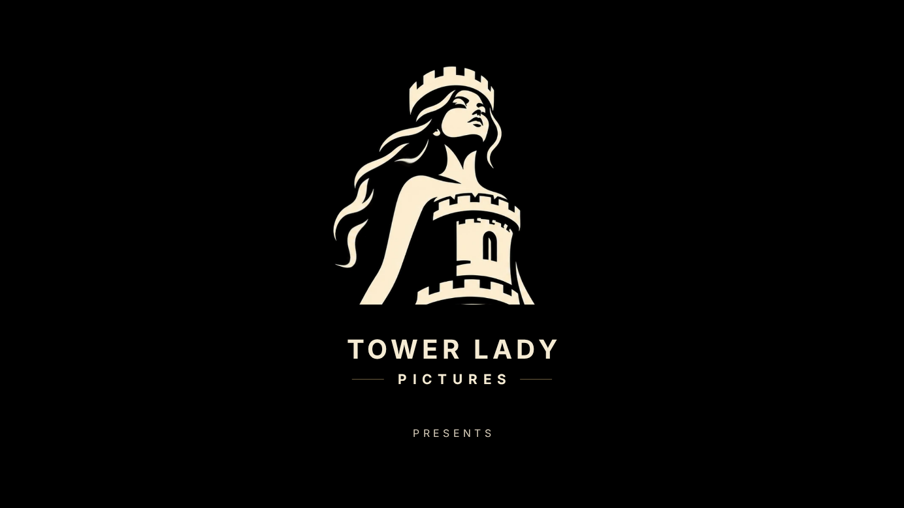

# Wybrany układ filmowego intra

Wariant A został zaakceptowany: animowany emblemat nad nazwą studia,
`PICTURES` w osobnym wierszu i mniejsze `PRESENTS` poniżej. Sam emblemat ma
optyczną korektę o 2% szerokości kadru w lewo. Napisy zachowują wspólną oś X 50%.

[Podgląd z animacją w Tailscale](https://vps.tailfb5686.ts.net:8766/prototypes/tower-lady-ograf/layout.prototype.html?variant=A&shift=-2)
pozwala porównać korektę z położeniem geometrycznie wycentrowanym.

## Typografia i kolor

Kadr referencyjny to UHD 3840 x 2160, 16:9. Rozmiary poniżej są stopniem
pisma w makiecie; nie są wartościami suwaka Size w Resolve.

| Napis | Czcionka | UHD / Full HD | Tracking | Kolor |
| --- | --- | --- | --- | --- |
| TOWER LADY | Inter Bold 700 | 112 / 56 px | +0,15 em | `#F5EBD3` |
| PICTURES | Inter Bold 700 | 58 / 29 px | +0,42 em | `#F5EBD3` |
| PRESENTS | Inter Regular 400 | 44 / 22 px | +0,35 em | `#D8CEBB` |

Tło: `#000000`. Linie przy `PICTURES`: `#9A8459`, po 136 x 2 px w UHD,
68 x 1 px w Full HD. Kolory są referencją sRGB do oceny w docelowej przestrzeni
barw projektu. Font: [Inter](https://rsms.me/inter/), ten sam co w logotypie strony.

## Położenie

- Emblemat: około 48% wysokości kadru, środek X 48%, Y 36% od góry.
- Warstwa istniejącego OGraf: Zoom 0,60; przesunięcie względem środka kadru
  o 76,8 px w lewo i 302,4 px w górę w UHD. W Full HD: 38,4 px w lewo
  i 151,2 px w górę. Kierunki są podane względem obrazu, niezależnie od
  konwencji osi w używanym narzędziu Resolve.
- TOWER LADY: środek wiersza około 69% wysokości, szerokość około 24% kadru.
- PICTURES: środek wiersza około 75% wysokości.
- PRESENTS: środek wiersza około 85% wysokości.
- Wszystkie napisy pozostają na osi X 50%; korekta optyczna dotyczy tylko emblematu.

Gotowy eksport `tower-lady-intro.ograf.json` zawiera tę kompozycję jako jeden
klip OGraf, z lokalnym fontem Inter. Nie wymaga ręcznego układania napisów.
[Podgląd kompletnego eksportu](https://vps.tailfb5686.ts.net:8766/prototypes/tower-lady-ograf/?graphic=intro).
Animacja wejścia i wyjścia oraz synchronizacja z 6-sekundowym podkładem
pozostają częścią montażu autora. Wszystkie napisy są widoczne jednocześnie.
